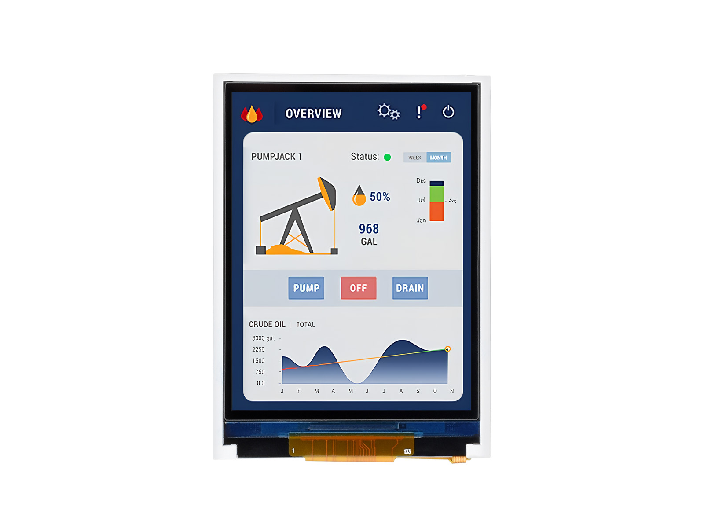

  <h1>ESP32-S3-LCD-2.8</h1>
  
<strong>ESP32-S3 development board with a 2.8-inch 240 × 320 LCD (SKU 30223)</strong>

  
<strong>English</strong> | <a href="README_ZH.md">简体中文</a>

  

    
    
  

  

    <a href="https://www.waveshare.com/esp32-s3-touch-lcd-2.8.htm">🛒 Product</a> &middot;
    <a href="firmware/">📦 Firmware</a> &middot;
    <a href="examples/esp-idf/">🧩 ESP-IDF</a> &middot;
    <a href="https://docs.waveshare.com/ESP32-S3-LCD-2.8/">📖 Documentation</a>
  

  

---

## ✨ Overview

This board includes a 2.8-inch LCD, a speaker, a six-axis IMU, and a microSD slot. This repository provides the ESP-IDF board test example.

| Feature | Device or interface |
| --- | --- |
| MCU | ESP32-S3R8 |
| Memory | 16 MB Flash, 8 MB PSRAM |
| Display | 2.8-inch, 240 × 320, SPI, ST7789T |
| Peripherals | QMI8658, PCF85063, PCM5101, microSD |

## 📦 Quick Start

Download the board test image and follow the instructions in [firmware/](firmware/). To run the ESP-IDF example, follow its guide below.

## 🧪 Examples

| Example | Main feature |
| --- | --- |
| [ESP32-S3-LCD-2.8-Test](examples/esp-idf/ESP32-S3-LCD-2.8-Test/) | Show board diagnostics with LVGL and play MP3 files from a microSD card |

## 🛠️ Development Environment

| Framework | Version | Examples |
| --- | --- | ---: |
| ESP-IDF | `v5.3.2` | 1 |

## 📚 Resources

- [Schematic](hardware/schematic/)
- [Product page](https://www.waveshare.com/esp32-s3-touch-lcd-2.8.htm)
- [Wiki](https://docs.waveshare.com/ESP32-S3-LCD-2.8/)

## 🤝 Support

- [Waveshare support](https://service.waveshare.com/)

## 📄 License

Bundled third-party code retains its respective license and copyright notices.
