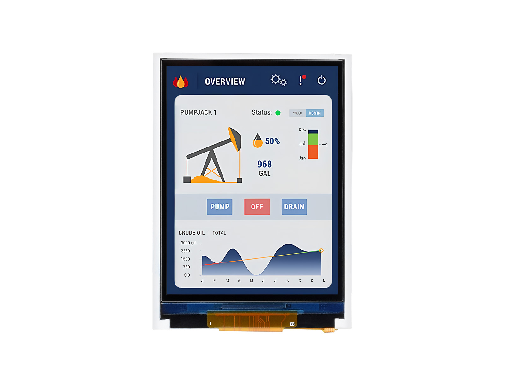

  <h1>ESP32-S3-LCD-2.8</h1>
  
<strong>ESP32-S3 2.8 英寸 240 × 320 LCD 开发板（SKU 30223）</strong>

  
<a href="README.md">English</a> | <strong>简体中文</strong>

  

    
    
  

  

    <a href="https://www.waveshare.com/esp32-s3-touch-lcd-2.8.htm">🛒 产品</a> &middot;
    <a href="firmware/">📦 固件</a> &middot;
    <a href="examples/esp-idf/">🧩 ESP-IDF</a> &middot;
    <a href="https://docs.waveshare.net/ESP32-S3-LCD-2.8/">📖 文档</a>
  

  

---

## ✨ 概述

这款开发板带有 2.8 英寸 LCD、扬声器、六轴惯性传感器和 microSD 卡槽。本仓库提供板载外设的 ESP-IDF 测试示例。

| 功能 | 器件或接口 |
| --- | --- |
| MCU | ESP32-S3R8 |
| 存储器 | 16 MB Flash，8 MB PSRAM |
| 显示 | 2.8 英寸，240 × 320，SPI，ST7789T |
| 外围器件 | QMI8658、PCF85063、PCM5101、microSD |

## 📦 快速开始

板载功能测试固件及烧录步骤见 [firmware/](firmware/)。如需运行 ESP-IDF 示例，请参照下方的示例说明。

## 🧪 示例

| 示例 | 主要功能 |
| --- | --- |
| [ESP32-S3-LCD-2.8-Test](examples/esp-idf/ESP32-S3-LCD-2.8-Test/README_ZH.md) | 通过 LVGL 展示板载外设状态，支持从 microSD 播放 MP3 |

## 🛠️ 开发环境

| 开发框架 | 版本 | 示例数 |
| --- | --- | ---: |
| ESP-IDF | `v5.3.2` | 1 |

## 📚 资料

- [原理图](hardware/schematic/)
- [产品页](https://www.waveshare.com/esp32-s3-touch-lcd-2.8.htm)
- [Wiki](https://docs.waveshare.net/ESP32-S3-LCD-2.8/)

## 🤝 支持

- [微雪技术支持](https://docs.waveshare.net/ESP32-S3-LCD-2.8/Technical-Support/)

## 📄 许可证

随附的第三方代码适用各自的许可证和版权声明。
